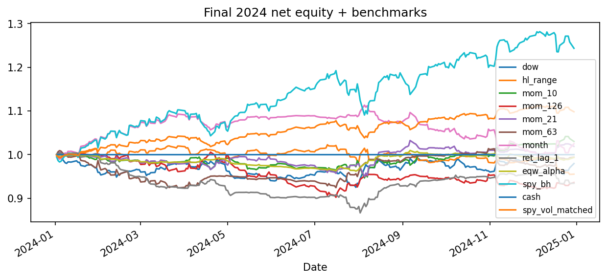
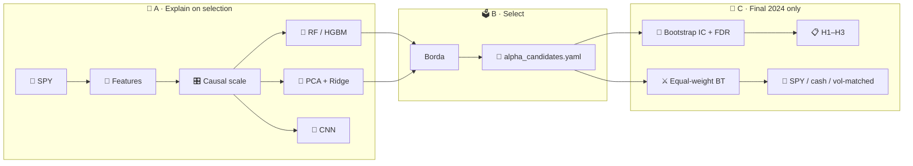
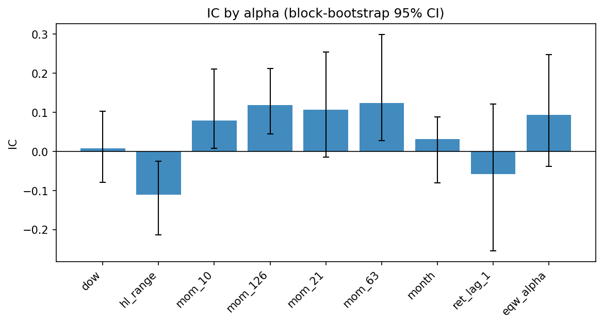
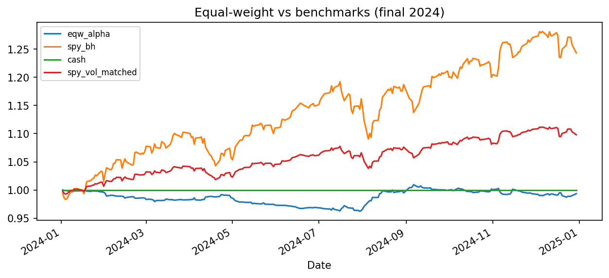
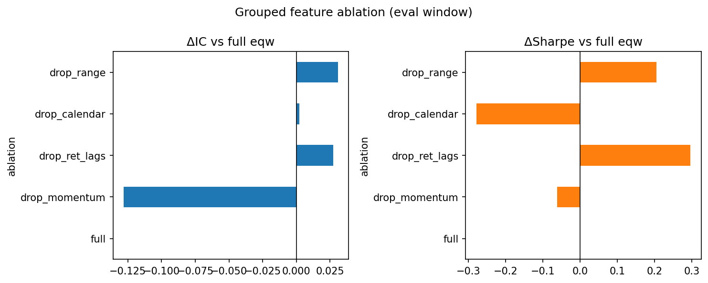

# 📈 SPY Alpha Research

### Interpretable feature attribution → alpha shortlist → one-shot final validation

> 🧠 **Not a price-prediction contest.**  
> Which features actually *explain* next-day SPY returns — and do the survivors still look like alpha after honest IC tests, hypotheses, and cost-aware timing backtests?

<p align="center">
  
  <br/>
  <sub>📊 Final-holdout equity overlay · regenerate via notebooks 08–09</sub>
</p>

```text
📡 SPY OHLCV
      │
      ▼
🧩 Causal features  ──►  🎛️ Expanding / rolling scale
      │
      ├─ 📉 ARIMA
      ├─ 🌲 Trees (RF / HGBM)
      ├─ 📐 PCA + Ridge / Kernel
      └─ 🧠 CNN
      │
      ▼
🗳️ Borda shortlist   (selection 2022–23 only)
      │
      ▼
🧪 Block-bootstrap IC · FDR · H1–H3
⚔️ Equal-weight timing + SPY benchmarks   (final 2024 only)
```

---

## 🗓️ Research contract

| 🏷️ Period | 📅 Dates | 🎯 Role |
|---|---|---|
| 🔒 Full sample | `2016-01-01` → `2024-12-31` | Hard cap — **no 2025+** |
| 🏋️ **Train** | → `2021-12-31` | Fit + purged expanding TSCV |
| 🔍 **Selection** | `2022-01-01` → `2023-12-31` | Attribution, Borda, model compare |
| 🏁 **Final** | `2024-01-01` → `2024-12-31` | One-shot IC / hyp / BT — **never** for selection |

- ⏱️ **Timestamp:** row `t` = known at close of day `t`. Target is always \(r_{t+1}\).
- 📏 **Scaling:** causal expanding / rolling only — never full-sample `StandardScaler`.
- ⚠️ **Legacy:** joint 2022–2024 numbers = exploratory only.

---

## 🗺️ Pipeline



| Stage | What you get |
|---|---|
| 🔎 **A** | Selection-window importance / saliency (classical · trees · PCA/kernel · CNN) |
| 🗳️ **B** | Frozen top-k shortlist → `data/processed/alpha_candidates.yaml` |
| 🏁 **C** | Final-only IC (bootstrap CI), hypotheses, timing PnL, benchmarks, ablation |

> 💡 Primary IC = **moving-block bootstrap** on the level series.  
> Rolling IC = **stability plots only** — no significance stars from overlapping windows.

<p align="center">
  
  <br/>
  <sub>🧪 IC by alpha with block-bootstrap 95% CI</sub>
</p>

---

## 🚀 Quick start

```bash
cd spy-alpha-research
python -m venv .venv
# Windows:  .venv\Scripts\activate
# Unix:     source .venv/bin/activate

pip install -e ".[dev]"
pytest
```

| Step | Do this |
|---|---|
| ✅ Tests | `pytest` |
| 📓 Chapters | notebooks `01` → `09` **in order** |
| 📄 PDF | `python scripts/build_research_pdf.py` → [`reports/research_report.pdf`](reports/research_report.pdf) |

> 🔄 After pulling code: **restart the Jupyter kernel** so the editable install reloads.  
> 📦 Pin snapshot: [`requirements.lock`](requirements.lock) · regenerate with `pip freeze` after a clean install.  
> 💾 Market data is **not** committed — notebook 01 downloads SPY; later steps rebuild `data/processed/` + figures.

---

## 📓 Notebook tour

| # | Notebook | Job |
|---|---|---|
| 1️⃣ | `01_data_and_stationarity` | 📡 Download SPY, returns, stationarity |
| 2️⃣ | `02_feature_engineering` | 🧩 Features + train / selection / final scaled panels |
| 3️⃣ | `03_autocorr_arima` | 📉 ACF/PACF + ARIMA baseline |
| 4️⃣ | `04_pipeline_trees` | 🌲 RF / HistGBM — **selection** perm-importance |
| 5️⃣ | `05_pipeline_pca_linear_kernel` | 📐 PCA + linear / kernel on selection |
| 6️⃣ | `06_pipeline_cnn` | 🧠 1D CNN — **selection** channel saliency |
| 7️⃣ | `07_attribution_synthesis` | 🗳️ Rank agreement + Borda + model compare |
| 8️⃣ | `08_alpha_ic_hypothesis` | 🧪 **Final 2024** IC, bootstrap, H1–H3 |
| 9️⃣ | `09_backtest_and_compare` | ⚔️ Final BT, benchmarks, grouped ablation |

<p align="center">
  
  &nbsp;
  
  <br/>
  <sub>🏦 Benchmarks · 🔬 Grouped ablation</sub>
</p>

---

## 🧰 Package layout

Installable library: `spy_alpha_research`

```text
src/spy_alpha_research/
├── 📡 data/            loaders, returns, split_three_way
├── 🧩 features/        causal factory + timestamp asserts
├── 🎛️ preprocessing/   ExpandingScaler / RollingScaler
├── 📉 classical/       ACF/PACF, ARIMA grid
├── 🤖 pipelines/       trees · pca_kernel · cnn
├── 🗳️ attribution/     Borda · rank stability · grouped ablation
├── ✨ alpha/           oriented signals · equal-weight blend
├── 🧪 statistics/      block-bootstrap IC · HAC · FDR · hypotheses
├── ⚔️ backtesting/     timing engine + SPY / cash / vol-matched
├── 🚶 validation/      purged expanding walk-forward
└── 📊 reporting/       plots · model_compare · comparison tables
```

| Config | Controls |
|---|---|
| ⚙️ `configs/experiment.yaml` | Dates, features, CV, alpha / bootstrap |
| 🧬 `configs/models.yaml` | ARIMA / tree / PCA / CNN knobs |
| 💸 `configs/backtest.yaml` | Signal lag, position map, costs |

---

## 🧭 Design choices

| Choice | Why |
|---|---|
| 🔀 Three-way split | Shortlist never peeks at final 2024 |
| 🎲 Block-bootstrap IC | Honest CI / p on level IC; rolling IC = plots only |
| 🔍 Selection attribution | Importance on 2022–2023 OOS — not the train fit |
| ⚖️ Equal-weight blend | Transparent combo — not another black box |
| 📋 Pre-registered H1–H3 | Less significance hunting after seeing final |
| 🎯 SPY-only + end ≤ 2024 | Fixed univariate lab; reproducible boundary |
| 🧊 Negative findings OK | Eqw need not beat singles or SPY buy-and-hold |

---

## 🧱 Stack

`Python ≥ 3.10` · pandas · statsmodels · scikit-learn · PyTorch · shap · yfinance · matplotlib · pytest · reportlab

---

## 📜 License

**Proprietary Source-Available** — Copyright © 2026 · see [`LICENSE`](LICENSE).

👀 Viewing & technical evaluation allowed.  
🚫 Reproduction, modification, distribution, and commercial use need prior written authorization from the copyright holder.
